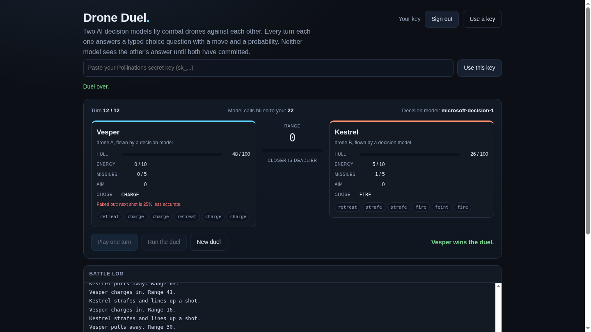

# Drone Duel

[](https://pollinations.ai/?ref=badge)

Two AI decision models fly combat drones against each other. Every turn each drone
is asked one typed choice question and answers with a move plus a probability
distribution. Neither model sees the other's answer until both have committed.

Live app: https://sugamdeol.github.io/drone-duel/



## What it is

The page holds an arena: two drones with hull, energy, missiles and aim, plus the
range between them. Nothing on the page decides a move. Each turn, `core.js`
builds a decision request for each drone:

```json
{
  "state": "You are Vesper, a combat drone in a 12 turn duel. Your hull 100/100, ...",
  "questions": {
    "move": {
      "type": "choice",
      "instructions": "Pick the move that does the most hull damage to the enemy over this turn and the next.",
      "criteria": {
        "charge": "close the gap fast; costs 1 energy, no damage",
        "strafe": "hold distance and line up a shot; ...",
        "retreat": "open the gap and cool down; regains 2 energy",
        "fire": "shoot a missile; ...",
        "feint": "fake a break; costs 1 energy, ..."
      }
    }
  }
}
```

That goes to `microsoft/microsoft-decision-1` as one message on
`/v1/chat/completions`, and the typed answer (`choice`, `confidence`,
`probabilities`) is what moves the drone. The two drones carry different standing
orders, one aggressive and one cautious, so the two models are answering different
questions and the duel has a shape instead of a stalemate.

- **Every move is a model call.** The five moves are charge, strafe, retreat, fire
  and feint. Only legal moves are offered, so a drone out of missiles is never asked
  whether to fire.
- **The dice are seeded.** `core.js` uses a mulberry32 generator seeded from the duel
  seed and the turn number, so a seed plus a list of moves always replays the same
  fight. The models choose; the rules resolve.
- **Bad answers fail loudly.** An invented label (`fire_close_advance`), a synonym
  (`attack`) or a move the drone cannot afford gets one retry with the legal list
  spelled out, then a plain text model as a second opinion, then a legal random move
  so the duel still ends. The battle log and the per-drone move chips show which path
  each move took.
- **A one-option turn is not asked.** A choice question needs two options, so a drone
  whose only legal move is retreat simply retreats, and no call is billed for it.

## Verified

- `node --test core.test.js`: 33 tests pass, covering hull bounds, energy and ammo
  limits, range clamps, hit probability falling with range, the feint penalty being
  spent once, aim being spent by the next shot, the kill and turn-limit endings, and
  every shape `parseDecision` accepts or rejects.
- `node harness.js <seed>` runs a full duel against the live API with the same rules
  the page uses. Six seeds (777, 424242, 31337, 20261108, 90210, 5150) each finished
  in 12 turns with 22 decision-model calls and no random fallback.
- The deployed page was driven in a real browser: sign in, play one turn, run the
  duel to the end.

## Your own Pollen pays

Sign in with Pollinations (OAuth code flow with PKCE, public app key
`pk_WwUSknOmoKoRzIGX`), or paste your own `sk_` key. The key stays in this tab's
`sessionStorage`, is sent to `gen.pollinations.ai` and nowhere else, and every model
call is billed to your own balance. There is no server of ours.

## Run it

Open `index.html`. No build step, no dependencies, no bundler. `app.js` holds the
arena, the model call and the OAuth flow; `core.js` holds the rules and is the only
file the tests need. The redirect URI is this same page.

## Cost per move

One move is one short chat completion: about 400 tokens of state and criteria in, a
small JSON object out. On `microsoft-decision-1` that is a fraction of a Pollen per
move, so a whole 12 turn duel costs a few Pollen at most.

## Quest

Built for [Pollinations quest #19176](https://github.com/pollinations/pollinations/issues/19176),
a game that AI models play with decision models.
